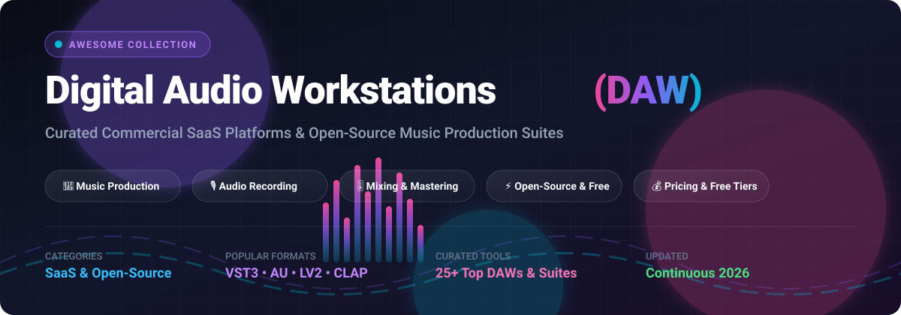

<div align="center">



# 🎛️ Awesome Digital Audio Workstation (DAW)

### 🎵 Top Digital Audio Workstations, Hosted SaaS Platforms & Open-Source Music Production Suites

<p align="center">
  <a href="https://github.com/ishandutta2007/Awesome-Awesome-Awesome"></a><a href="https://discord.gg/jc4xtF58Ve"></a>
  <a href="https://github.com/ishandutta2007/Awesome-Digital-Audio-Workstation-Daw/stargazers"></a>
  <a href="https://github.com/ishandutta2007/Awesome-Digital-Audio-Workstation-Daw/network/members"></a>
  <a href="https://github.com/ishandutta2007/Awesome-Digital-Audio-Workstation-Daw/issues"></a>
  <a href="https://github.com/ishandutta2007/Awesome-Digital-Audio-Workstation-Daw/blob/main/LICENSE"></a>
  <a href="https://github.com/ishandutta2007"></a>
</p>

<p align="center">
  <strong>An exhaustive, curated collection of the finest Digital Audio Workstations (DAW), audio sequencers, waveform editors, mixing consoles, and modular synthesizer software for music producers, sound designers, mastering engineers, and podcasters.</strong>
</p>

<p align="center">
  <em>Updated regularly with transparent starting prices, free tier limits, and valuation metrics • October 2026</em>
</p>

</div>

---

## 📑 Table of Contents
- [🔍 Overview & SEO Highlights](#-overview--seo-highlights)
- [📊 Sector Overview & Market Dynamics](#-sector-overview--market-dynamics)
- [🏢 Commercial / SaaS Platforms](#-commercial--saas-platforms)
- [🔓 Open-Source GitHub Projects](#-open-source-github-projects)
- [💡 Choosing the Right DAW: Buyer & Developer Guide](#-choosing-the-right-daw-buyer--developer-guide)
- [🤝 How to Contribute](#-how-to-contribute)
- [💖 Support & Sponsorship](#-support--sponsorship)
- [⭐ Star History](#star-history)
- [⚖️ Disclaimer & License](#️-disclaimer--license)

---

## 🔍 Overview & SEO Highlights

Whether you are looking for an industry-standard commercial studio DAW like **Avid Pro Tools**, **Ableton Live**, or **Logic Pro**, or seeking powerful **FOSS (Free and Open-Source Software)** alternatives like **Audacity**, **Ardour**, and **LMMS**, this directory provides comprehensive side-by-side insights.

### 🌟 Key Focus Areas
- 🎹 **Music Production & Sequencing**: Full MIDI orchestration, step sequencing, piano roll editing, and virtual instrument (VST3/AU/CLAP/LV2) hosting.
- 🎙️ **Multitrack Recording & Podcasting**: Low-latency multichannel tracking, vocal tuning, noise gate suppression, and spectral repair.
- 🎚️ **Mixing & Audio Engineering**: Dynamic routing, bus grouping, sidechaining, automation lanes, and spatial/Dolby Atmos audio mastering.
- 💻 **Platform Portability**: Native cross-platform support across macOS, Windows, Linux, and web browser cloud DAWs.

---

## 📊 Sector Overview & Market Dynamics

The global Digital Audio Workstation (DAW) software and hardware ecosystem market size is estimated at approximately **$3.8 billion to $4.5 billion in 2026**, on track to expand at a compound annual growth rate (CAGR) of ~7.5%–9.0% through the 2030s propelled by independent creators, podcasting, and AI-assisted production workflows.

The DAW sector is **moderately fragmented yet anchored by high switching costs and established institutional incumbents**: while a handful of dominant legacy players (Avid Pro Tools in studio tracking/film scoring, Apple Logic Pro and Steinberg Cubase in composition, and Ableton Live/FL Studio in electronic production) command dedicated user bases, the market remains non-monopolistic due to strong segment specialization, diverse workflow paradigms, and vibrant open-source alternatives.

---

## 🏢 Commercial / SaaS Platforms

> 📌 *Sorted by company size, market capitalization, revenue, or acquisition valuation (descending).*

| Product / Company | 🏢 Company Size (Revenue / Valuation) | 💵 Pricing (Starting Tier) | 🎁 Free Tier / Trial Limits | 📝 Description |
| :--- | :--- | :--- | :--- | :--- |
| **[Apple Logic Pro](https://www.apple.com/logic-pro/)** (Apple Inc.) | **$3.5T+ Market Cap** ($390B+ Annual Revenue) | $199.99 one-time purchase (Mac); iPadOS version starts at $4.99/month or $49/year | **90-day fully functional free trial** for macOS with all plugins and content packs; iPad version provides a **1-month free trial** | Flagship macOS DAW featuring a massive collection of virtual instruments, Dolby Atmos spatial audio mixing, and production tools. |
| **[Adobe Audition](https://www.adobe.com/products/audition.html)** (Adobe Inc.) | **~$200B+ Market Cap** ($21.4B Annual Revenue) | $22.99/month (annual paid monthly) or $34.49/month (month-to-month); Creative Cloud All Apps at $59.99/month | **7-day free trial** with complete access to all multitrack editing, spectral frequency display, and restoration features | Specialized multitrack audio recording, restoration, and waveform editing platform tightly integrated into Adobe Creative Cloud. |
| **[Steinberg Cubase](https://www.steinberg.net/cubase/)** (Yamaha Corporation) | **$3B+ Parent Revenue** (Steinberg est. €30M–€50M/yr) | $99.99 one-time license for Cubase Elements; Artist at $329.99; Pro at $579.99 | **60-day free trial** of Cubase Pro with unrestricted audio tracks, MIDI features, and stock VST instruments | Long-standing professional workstation recognized for advanced MIDI sequencing, orchestral composition, and audio pitch editing (VariAudio). |
| **[Avid Pro Tools](https://www.avid.com/pro-tools)** (Symphony Technology Group) | **$1.4B Acquisition Valuation** (~$400M+ Annual Revenue) | $9.99/month or $99/year (Pro Tools Artist); Pro Tools Studio at $29.99/month | **30-day free trial** of Pro Tools Studio (unlimited I/O, full plugin bundle); also offers *Pro Tools Intro* as a permanent free tier limited to 16 audio/MIDI tracks and 4 inputs | The definitive recording industry and post-production standard for tracking, multitrack audio editing, mixing, and hardware integration. |
| **[PreSonus Studio One](https://www.presonus.com/products/Studio-One)** (Fender Musical Instruments) | **$50M–$100M+ Revenue** (Fender ~$1B+ Parent Revenue) | $19.99/month or $179.99/year via Studio One+ subscription; perpetual Pro license at $399.99 | **30-day full-featured free trial** of Studio One Pro with zero feature limitations | Modern drag-and-drop DAW integrating recording, sequencing, mastering project pages, and live performance sets. |
| **[Ableton Live](https://www.ableton.com/)** (Ableton AG) | **~$100M+ Annual Revenue** (Bootstrapped & profitable) | $99 one-time purchase (Live 12 Intro); Standard at $439; Suite at $749 | **30-day free trial** of Live Suite with all synths, packs, Max for Live devices, and saving/export enabled | Dual-interface DAW combining Session View clip launching with a linear Arrangement View, dominating electronic music and live stage setups. |
| **[FL Studio](https://www.image-line.com/fl-studio/)** (Image-Line Software) | **~$45M–$60M Annual Revenue** | $99 one-time purchase (Fruity Edition); Producer at $199; Signature at $299; All Plugins at $499 (includes lifetime free updates) | **Unlimited duration free trial** allowing access to all features and plugins; projects can be saved but cannot be reopened until a license is purchased | Pattern-based beatmaking and production environment featuring lifetime free updates and an intuitive step sequencer / piano roll. |
| **[BandLab / Cakewalk](https://www.bandlab.com/)** (Caldecott Music Group) | **$425M Valuation** (~$48M Annual Revenue) | Free base cloud DAW; BandLab Membership starting at $14.95/month or $149.50/year | **Free forever plan** with unlimited cloud tracks, 16 audio/MIDI channels per project, social collaboration tools, and community storage | Collaborative cloud and mobile DAW coupled with Cakewalk Sonar desktop software, offering free song creation and distribution tools. |
| **[Magix Sound Forge](https://www.magix.com/us/music/sound-forge/)** (MAGIX Software GmbH) | **~$30M–$50M Annual Revenue** | $14.99/month subscription (Pro 365) or $399 one-time perpetual license (Sound Forge Audio Studio starts at $59.99) | **30-day free trial** with access to high-resolution multichannel audio editing, mastering tools, and spectral analysis | Precision digital audio editing and mastering platform suited for waveform surgery, broadcast restoration, and CD authoring. |
| **[REAPER](https://www.reaper.fm/)** (Cockos Incorporated) | **~$5M–$15M Annual Revenue** (Independent boutique firm) | $60 one-time discounted license (for individuals/small businesses earning <$20k/yr); $225 commercial license | **60-day fully functional, nag-free evaluation period** with no artificial track, save, export, or plugin limitations | Ultralight, deeply customizable digital audio workstation with unmatched CPU efficiency, routing flexibility, and ReaScript scripting support. |

---

## 🔓 Open-Source GitHub Projects

> 📌 *Sorted by GitHub_Stars (descending). Badges link directly to each project's stargazers page.*

| Project | ⭐ GitHub_Stars | 🎧 Primary Focus & Capabilities |
| :--- | :--- | :--- |
| **[Audacity](https://github.com/audacity/audacity)** | [](https://github.com/audacity/audacity/stargazers) | World's most popular open-source multitrack audio recorder and waveform editor, built for quick audio surgery, noise suppression, and podcasting. |
| **[MuseScore](https://github.com/musescore/MuseScore)** | [](https://github.com/musescore/MuseScore/stargazers) | Open-source music notation and composition studio with realistic Muse Sounds orchestral playback and MIDI/audio export. |
| **[LMMS](https://github.com/LMMS/lmms)** | [](https://github.com/LMMS/lmms/stargazers) | Cross-platform beatmaking and synthesizer workstation modeled around FL Studio workflows with built-in synths, sample tracks, and soundfont support. |
| **[Ardour](https://github.com/Ardour/ardour)** | [](https://github.com/Ardour/ardour/stargazers) | Professional-grade recording, mixing, and mastering workstation with arbitrary routing, unlimited tracks, and industry-level LV2/VST3 plugin support. |
| **[Bespoke Synth](https://github.com/BespokeSynth/BespokeSynth)** | [](https://github.com/BespokeSynth/BespokeSynth/stargazers) | Node-based modular DAW and synthesizer environment designed for live jam improvisation, algorithmic sequencing, and sonic experimentation. |
| **[VCV Rack Community Edition](https://github.com/VCVRack/Rack)** | [](https://github.com/VCVRack/Rack/stargazers) | Open Eurorack virtual modular synthesizer and production environment supporting thousands of voltage-controlled oscillator, filter, and sequencer modules. |
| **[Helio Workstation](https://github.com/helio-fm/helio-workstation)** | [](https://github.com/helio-fm/helio-workstation/stargazers) | Linear composition-centric music sequencer with a clean user experience, cross-platform cloud sync, integrated version control, and VST plugin hosting. |
| **[Cardinal](https://github.com/DISTRHO/Cardinal)** | [](https://github.com/DISTRHO/Cardinal/stargazers) | Fully self-contained, open-source virtual modular synthesizer and audio processor plugin/standalone host based on VCV Rack. |
| **[Zrythm](https://github.com/zrythm/zrythm)** | [](https://github.com/zrythm/zrythm/stargazers) | Modern C/GTK4 DAW engineered for electronic music production, featuring chord assistance, flexible automation curves, and LV2/VST3 compatibility. |
| **[Carla](https://github.com/falkTX/Carla)** | [](https://github.com/falkTX/Carla/stargazers) | Powerful modular audio plugin host, patchbay, and rack supporting LADSPA, DSSI, LV2, VST2, VST3, and AU formats with bridging across architectures. |
| **[Giada](https://github.com/monocasual/giada)** | [](https://github.com/monocasual/giada/stargazers) | Minimalist, ultra-fast loop machine and live sampler for DJs, performers, and electronic producers with MIDI controller support and low latency. |
| **[OpenMPT](https://github.com/OpenMPT/openmpt)** | [](https://github.com/OpenMPT/openmpt/stargazers) | Renowned tracker-style audio workstation based on ModPlug Tracker, offering native support for dozens of legacy and modern tracker module formats. |
| **[Tenacity](https://github.com/tenacityteam/tenacity)** | [](https://github.com/tenacityteam/tenacity/stargazers) | Privacy-respecting, community-governed multitrack audio editor and recording suite forked from Audacity. |
| **[Qtractor](https://github.com/rncbc/qtractor)** | [](https://github.com/rncbc/qtractor/stargazers) | Mature multi-track audio and MIDI sequencing DAW tailored for Linux desktops using C++ and the Qt application framework over JACK/ALSA/PipeWire. |
| **[Rosegarden](https://github.com/tedfelix/rosegarden-official)** | [](https://github.com/tedfelix/rosegarden-official/stargazers) | Classical MIDI sequencer, score editor, and musical composition workspace designed around standard Western music notation. |

---

## 💡 Choosing the Right DAW: Buyer & Developer Guide

```
                      ┌─────────────────────────────┐
                      │ What is your primary need?  │
                      └──────────────┬──────────────┘
                                     │
           ┌─────────────────────────┼─────────────────────────┐
           ▼                         ▼                         ▼
   [Live Performance         [Studio Tracking /        [Modular / Beat /
    & Electronic]              Mixing / Scoring]        Open-Source FOSS]
           │                         │                         │
     Ableton Live               Avid Pro Tools            Ardour (Full DAW)
      FL Studio                 Logic Pro (macOS)         LMMS (Beats/Synths)
     Bitwig Studio              Cubase / REAPER           VCV Rack / Bespoke
```

- **For Beginners & Beatmakers**: Start with **FL Studio** (unlimited trial & lifetime updates) or **LMMS** (100% free open-source alternative).
- **For Audio Engineers & Podcasters**: Look into **REAPER** (hyper-efficient 60-day full trial) or **Audacity** / **Tenacity** for fast voiceover editing.
- **For Serious Studio Recordists**: **Avid Pro Tools** or **PreSonus Studio One** for unmatched hardware routing and multitrack editing workflows.
- **For Open-Source Purists**: Chain **Ardour** (multitrack recording/mixing) + **Carla** (plugin rack) + **Bespoke Synth** (modular algorithmic sequencing).

---

## 🤝 How to Contribute

Contributions are welcome and highly encouraged! Here is how you can help:
1. 🍴 Fork this repository.
2. 🌿 Create your feature branch (`git checkout -b feature/add-new-daw`).
3. 📝 Add or update entries with verified pricing, trial limits, and official URLs.
4. 🚀 Push to the branch (`git push origin feature/add-new-daw`).
5. 📬 Open a Pull Request with a clear description of changes.

---

## 💖 Support & Sponsorship

If you find this curated collection useful for your music production setup, audio engineering workflows, or research, please consider supporting the project!

- ⭐ **Star this repository** to help others discover it.
- 🍴 **Fork and share** with fellow producers, engineers, and creators.
- ☕ **Sponsor or buy a coffee**: Support ongoing maintenance and curated open-source research directly via the [GitHub Sponsor Dashboard](https://github.com/sponsors/ishandutta2007).

Your support keeps this directory independent, accurate, and up-to-date! 🎶

---

##  Star History
[](https://star-history.dera.page/#ishandutta2007/Awesome-Digital-Audio-Workstation-Daw&type=date&legend=top-left)

---

## ⚖️ Disclaimer & License

- This list is community-curated for informational and comparative purposes only. Brand names, logos, and trademarks belong to their respective copyright holders.
- Audio production setups are highly dependent on specific operating system latency, audio interface drivers (ASIO/CoreAudio/ALSA/PipeWire), and plugin architecture (VST3, AU, LV2, CLAP). Always test evaluation versions prior to production deployment.

<div align="center">
  <sub>Curated with ❤️ by <a href="https://github.com/ishandutta2007">Ishan Dutta</a> and the global audio creator community.</sub>
</div>
